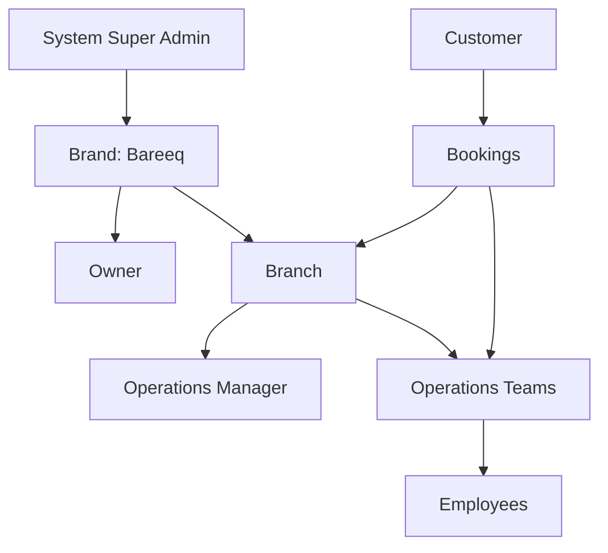
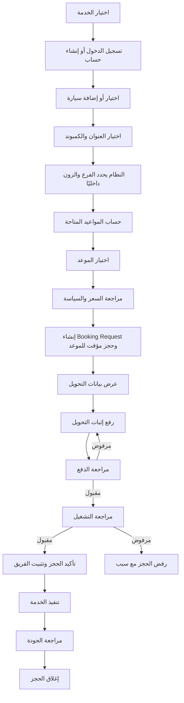

# BAREEQ Master Vibe-Coding Prompt

> انسخ هذا الملف كاملًا وأرسله إلى نموذج البرمجة كما هو. هذا الملف هو **المواصفة النهائية الملزمة** للمشروع. لا تضف خصائص خارج النطاق، ولا تحذف أي Workflow أو صلاحية أو قاعدة عمل مذكورة هنا.

---

## 0. الدور المطلوب منك

أنت تعمل الآن كفريق كامل مكوّن من:

- Product Architect
- Senior Full-Stack Engineer
- Database Architect
- UX/UI Designer
- Security Engineer
- QA Engineer
- DevOps Engineer

مهمتك هي تصميم وبناء تطبيق ويب Production-Ready باسم:

# **Bareeq Premium Mobile Car Care & Operations System**

المشروع ليس Prototype بصريًا فقط، وليس مجموعة صفحات Static، وليس Dashboard وهميًا. المطلوب نظام كامل يعمل من البداية إلى النهاية، يشمل قاعدة البيانات، المصادقة، الصلاحيات، الحجز، الجدولة، إدارة الفرق، الدفع اليدوي، Checklists التنفيذ، الاشتراكات، الإلغاءات، التقارير، وسجل التعديلات.

ابدأ بفهم المواصفة كاملة، ثم أنشئ خطة تنفيذ مرتبة، وبعدها نفّذ المشروع فعليًا. لا تكتفِ بشرح ما ستفعله.

---

# 1. تعريف المنتج النهائي

بريق هو براند يقدم خدمة عناية متنقلة فاخرة بالسيارات، ويصل إلى العميل في المنزل أو مكان العمل أو داخل الكمبوند.

النظام المطلوب يتكوّن من جزأين مترابطين:

1. **Public Premium Website**
   - يعرض البراند والخدمات كبطاقات منتجات.
   - يسمح للعميل بإنشاء حساب.
   - يسمح للعميل باختيار خدمة وسيارة وموقع وموعد متاح.
   - يسمح برفع إثبات التحويل اليدوي.
   - يسمح بمتابعة الحجوزات والاشتراكات وطلبات الإلغاء.

2. **Private Operations System**
   - يدير الفروع ومناطق التغطية.
   - يدير فرق التشغيل والموظفين.
   - يدير أوقات العمل والإجازات وعدم التوفر.
   - يحسب المواعيد المتاحة بناءً على القدرة الحقيقية للفرق.
   - يوزع الحجوزات يدويًا أو تلقائيًا.
   - يراجع التحويلات اليدوية.
   - يدير دورة تنفيذ الخدمة بالصور والـ Checklists.
   - يدير الإلغاء والتأجيل والاسترداد اليدوي.
   - يدير الاشتراكات والزيارات المتبقية.
   - يعرض تقارير تشغيلية ومالية أساسية.

الموقع **ليس SaaS** وليس Multi-Tenant Platform لعدة شركات. هو نظام خاص ببراند بريق فقط، لكنه يدعم أكثر من فرع داخل نفس البراند من الناحية التقنية.

---

# 2. القيود الصارمة وغير القابلة للتغيير

## 2.1 أشياء يجب أن تكون موجودة

- موقع عام فخم للعميل.
- عرض الخدمات كمنتجات.
- صفحات تفاصيل مستقلة لكل خدمة.
- حجز كامل من داخل الموقع.
- حسابات عملاء.
- حساب Owner.
- حساب Operations Manager.
- حساب Employee.
- حساب System Super Admin مخفي.
- فروع ومناطق تغطية.
- فرق تشغيل متعددة داخل الفرع الواحد.
- Manual Assignment وAutomatic Assignment.
- جدول مواعيد يعتمد على توافر الفرق الحقيقي.
- دفع يدوي بإثبات تحويل.
- مراجعة يدوية للدفع.
- Checklists قبل وأثناء وبعد الخدمة.
- صور قبل وبعد.
- طلبات إلغاء وتأجيل.
- استرداد يدوي مسجل.
- اشتراكات وزيارات متبقية.
- Audit Log.
- Soft Delete.
- Role-Based Access Control.
- تصميم عربي RTL وMobile-First.

## 2.2 أشياء خارج النطاق ويُمنع إضافتها

لا تضف أيًا من التالي:

- لا يوجد SaaS أو شركات متعددة.
- لا يوجد نظام اشتراك لاستخدام البرنامج.
- لا يوجد Chatbot.
- لا يوجد Live Chat داخلي.
- لا يوجد WhatsApp API.
- لا يتم سحب أو تخزين محادثات WhatsApp.
- لا توجد رسائل WhatsApp آلية.
- لا توجد رسائل SMS.
- لا توجد Emails آلية مطلوبة في النسخة الأساسية.
- لا يوجد Payment Gateway.
- لا يوجد Stripe أو Paymob أو Fawry API.
- لا يوجد Marketing & Ads Dashboard.
- لا يوجد Meta Ads Integration.
- لا يوجد Google Ads Integration.
- لا يوجد Meta Pixel Module داخل لوحة التحكم.
- لا يوجد CRM خارجي.
- لا يوجد Zapier أو Make.
- لا توجد Automation تسويقية.
- لا يوجد Google Maps API.
- لا يوجد Live GPS Tracking.
- لا يوجد Route Optimization API خارجي.
- لا يوجد Inventory Module في النسخة الأساسية.
- لا يوجد نظام محاسبة كامل.
- لا يوجد Marketplace لمزودي خدمة مختلفين.

المسموح به فقط من الاتصالات الخارجية:

- الاستضافة.
- قاعدة البيانات.
- تخزين الملفات المرتبط بالاستضافة إن لزم.
- زر اتصال هاتفي.
- رابط فتح WhatsApp باستخدام `wa.me` فقط.

لا ترسل أي رسائل تلقائية عبر WhatsApp. الزر يفتح المحادثة فقط.

---

# 3. التقنية المطلوبة

استخدم Stack حديثًا وقابلًا للنشر والإدارة:

## Frontend

- Next.js 15+ باستخدام App Router.
- React 19+.
- TypeScript مع `strict: true`.
- Tailwind CSS.
- shadcn/ui أو Radix UI للمكونات الأساسية.
- React Hook Form.
- Zod للتحقق من البيانات.
- TanStack Table للجداول.
- مكتبة Calendar احترافية مثل FullCalendar أو Scheduler مخصص.
- Recharts للتقارير التشغيلية والمالية الداخلية فقط.

## Backend

- Next.js Server Actions وRoute Handlers أو طبقة Service واضحة.
- PostgreSQL 16+.
- Prisma ORM.
- Database migrations فعلية.
- معاملات Database Transactions للعمليات الحساسة.
- Auth.js Credentials أو Authentication داخلي آمن.
- Argon2id أو bcrypt القوي لتشفير كلمات المرور.
- Session Cookies آمنة من نوع HTTP-only وSecure وSameSite.

## File Storage

- في التطوير: تخزين محلي في مجلد Persistent مثل `/data/uploads`.
- في الإنتاج: Storage Adapter قابل للاستبدال باستخدام Persistent Volume أو S3-compatible infrastructure عند الضرورة.
- لا تستخدم خدمة Media SaaS خارجية إجبارية.
- إثباتات الدفع والصور ملفات Private ولا تكون Public URLs مفتوحة.
- الوصول للملفات يجب أن يتم من خلال Authorized Route أو Signed Temporary Access.

## Testing

- Vitest للوحدات والمنطق.
- Playwright لاختبارات End-to-End.
- Tests للصلاحيات والحجز ومنع التعارض والدفع والإلغاء والاشتراكات.

## Deployment

- Dockerfile.
- docker-compose للتشغيل المحلي مع PostgreSQL.
- `.env.example` كامل.
- README واضح للتشغيل والنشر.

إذا تعذر استخدام إصدار بعينه استخدم أحدث إصدار Stable مع الحفاظ على نفس المعمارية.

---

# 4. مبادئ التنفيذ الأساسية

- لا تبنِ واجهات Mock فقط.
- كل زر رئيسي يجب أن يعمل.
- كل Form يجب أن يحفظ في قاعدة البيانات.
- كل حالة Booking يجب أن تطبق قواعد الانتقال الفعلية.
- لا تستخدم بيانات Hardcoded بدل قاعدة البيانات إلا في Seed Data.
- لا تترك TODOs أو صفحات فارغة.
- لا تستخدم `any` إلا لضرورة موثقة.
- افصل Business Logic عن UI.
- استخدم Service Layer واضحة للجدولة والتوزيع والدفع والاشتراكات.
- نفّذ Audit Logs لكل العمليات الحساسة.
- استخدم Transactions عند حجز الموعد أو خصم زيارة أو اعتماد الدفع.
- امنع Double Booking على مستوى التطبيق وقاعدة البيانات.
- اجعل النظام قابلًا للتوسع لفروع أكثر، مع استمرار حد الفرع الواحد افتراضيًا.

---

# 5. هوية وتصميم بريق

## 5.1 شخصية البراند

يجب أن يظهر بريق كالتالي:

- Premium.
- Elegant.
- Organized.
- Trustworthy.
- Automotive Luxury.
- ليس مغسلة سيارات رخيصة.
- ليس SaaS تقنيًا عامًا.
- ليس تصميمًا مزدحمًا أو طفوليًا.

## 5.2 الألوان

استخدم فقط نظامًا متوازنًا من:

- Black: `#080808` أو قريب منه.
- Deep Charcoal: `#141414`.
- White: `#FFFFFF`.
- Warm Off-White: `#F7F4ED`.
- Premium Gold Primary: `#C9A227`.
- Gold Light: `#E5C45A`.
- Gold Dark: `#8C6813`.
- Neutral Gray للنصوص والجداول.

لا تستخدم ألوانًا زاهية خارج الهوية إلا ألوان الحالة الوظيفية:

- Green للنجاح.
- Amber للانتظار.
- Red للرفض أو الخطأ.
- Blue للمعلومات.

## 5.3 الخطوط والاتجاه

- اللغة الأساسية للواجهة: العربية.
- اتجاه التطبيق الافتراضي: RTL.
- استخدم خطًا عربيًا حديثًا وواضحًا مثل `Alexandria` للعناوين و`Tajawal` للنصوص.
- استخدم Inter أو النظام للإنجليزية.
- احترم اتجاه المصطلحات الإنجليزية داخل النص العربي باستخدام Bidi Isolation.
- لا تجعل المصطلحات الإنجليزية تقلب ترتيب الجملة العربية.

## 5.4 الحركة

- Animations خفيفة وراقية.
- Subtle gold glow.
- Reveal on scroll محسوب.
- Hover states واضحة.
- لا تستخدم حركات ثقيلة تعطل الهاتف.
- احترم `prefers-reduced-motion`.

## 5.5 أسلوب اللوحات

- Public Website داكن وفخم.
- Dashboard يمكن أن يكون Light Neutral مع Headers داكنة ولمسات ذهبية لضمان سهولة القراءة.
- Cards نظيفة.
- Tables واضحة.
- Status badges ملونة وظيفيًا.
- Mobile views لا تكون نسخًا مصغرة من Desktop فقط؛ صممها فعليًا للهاتف.

---

# 6. خريطة الموقع العامة

أنشئ الصفحات العامة التالية:

```text
/
/services
/services/[slug]
/services/[slug]/book
/plans
/areas
/before-after
/about
/faq
/policies/booking
/policies/cancellation
/policies/privacy
/contact
/login
/register
/account
/account/bookings
/account/bookings/[id]
/account/vehicles
/account/addresses
/account/subscriptions
/account/subscriptions/[id]
/account/profile
```

لوحة النظام:

```text
/system-admin/*
/admin/*
/operations/*
/staff/*
```

كل Route يجب أن تكون محمية حسب الدور.

---

# 7. الـ Landing Page النهائية

## 7.1 Header

يحتوي على:

- شعار بريق.
- الرئيسية.
- الخدمات.
- الباقات.
- مناطق الخدمة.
- قبل وبعد.
- لماذا بريق.
- الأسئلة الشائعة.
- تسجيل الدخول.
- زر أساسي: **احجز الآن**.

على الهاتف استخدم Menu واضحًا وسريعًا.

## 7.2 Hero Section

العنوان العربي المقترح:

> **عناية متنقلة فاخرة بسيارتك في المكان والموعد المناسبين لك**

الوصف:

> بريق تقدم خدمة عناية احترافية متنقلة باستخدام مواد مخصصة لكل جزء من السيارة، مع حجز منظم، فريق تشغيل محترف، وصور قبل وبعد الخدمة.

الأزرار:

- **احجز خدمتك الآن** → `/services`
- **استعرض الباقات** → `/plans`

أضف Visual فاخر لسيارة سوداء أو فضية مع لمعان ذهبي، لكن حافظ على سرعة الصفحة.

## 7.3 Value Proposition

أربع بطاقات:

1. **راحة** — الخدمة تصل إلى موقع العميل.
2. **حماية** — مواد مناسبة لكل سطح.
3. **تنظيم** — مواعيد حقيقية حسب توافر فرق التشغيل.
4. **استمرارية** — اشتراكات وزيارات دورية.

## 7.4 Why Traditional Washing Is Not Enough

قسم توعوي مختصر وغير مخيف يتحدث عن:

- الوقت والانتظار.
- عدم وضوح المواد المستخدمة.
- احتمالية الخدوش بسبب أدوات غير مناسبة.
- آثار المياه إذا تم التجفيف بصورة خاطئة.
- أهمية التعامل المتخصص مع الدهان والجلد والزجاج والجنوط.

تجنب الادعاءات العلمية أو القانونية غير المثبتة. استخدم صياغة احتمالية وليست قطعية.

## 7.5 Services Preview

اعرض الخدمات كمنتجات ببطاقات فاخرة تحتوي على:

- الصورة.
- الاسم.
- وصف مختصر.
- مدة تقريبية.
- السعر أو `يبدأ من`.
- زر **عرض التفاصيل**.
- زر **احجز الخدمة**.

## 7.6 How Booking Works

استخدم الخطوات التالية:

1. اختر الخدمة.
2. أضف السيارة أو اختر سيارة محفوظة.
3. اختر موقع التنفيذ.
4. اختر موعدًا متاحًا فعليًا.
5. ارفع إثبات التحويل.
6. تابع قبول الحجز من حسابك.
7. ينفذ الفريق الخدمة ويرفع صور قبل وبعد.

لا تعرض للعميل أسماء الزونات الداخلية أو جداول الفرق الداخلية.

## 7.7 Before / After Gallery

- صور مرتبطة بحجوزات مكتملة.
- لا تعرض صورة للعامة إلا بعد تحديد `approved_for_public_gallery = true`.
- يجب وجود موافقة العميل على استخدام الصور.
- يمكن الفلترة حسب نوع الخدمة أو نوع السيارة.

## 7.8 Service Areas

اعرض مناطق الخدمة الحالية فقط.

Seed أولي للفرع الأول في الشيخ زايد:

- Beverly Hills.
- SODIC.
- Allegria.
- Westown.
- Karma 1.
- Karma 2.
- Karma 3.
- Karma 4.
- Al Rabwa.
- Al Yasmeen.
- District 8.
- District 9.
- District 10.
- District 11.

النص المقترح:

> **نخدم حاليًا مناطق مختارة في الشيخ زايد لضمان جودة التنفيذ والالتزام بالمواعيد.**

## 7.9 Trust Section

اعرض:

- صور الفريق واليونيفورم.
- المواد المستخدمة.
- Checklists.
- صور قبل وبعد.
- تقييمات العملاء المنشورة.
- سياسة معالجة الملاحظات.
- رابط سياسة الإلغاء والتأجيل.

## 7.10 Subscriptions Section

اعرض خطط الاشتراك النشطة من قاعدة البيانات، مع:

- اسم الخطة.
- السعر.
- عدد الزيارات.
- المدة.
- السيارات المسموح بها.
- الخدمات المشمولة.
- زر الاشتراك أو عرض التفاصيل.

## 7.11 FAQ

أضف على الأقل:

- هل الخدمة تحتاج مصدر مياه؟
- كيف أختار الموعد؟
- متى يتم تأكيد الحجز؟
- كيف أرفع إثبات التحويل؟
- ماذا يحدث إذا كان الإثبات غير صحيح؟
- هل يمكن تعديل الموعد؟
- هل يمكن إلغاء الحجز؟
- كيف يتم التعامل مع الاسترداد؟
- هل يمكن استخدام الاشتراك لأكثر من سيارة؟
- هل الخدمة متاحة خارج مناطق التغطية؟
- كيف أتواصل مع الفرع عبر WhatsApp؟

## 7.12 Final CTA

> **اختر الخدمة المناسبة واترك نظام بريق ينظم باقي التجربة.**

زر: **ابدأ الحجز**.

---

# 8. الخدمات كمنتجات

## 8.1 نموذج الخدمة

كل Service Product يحتوي على:

- `name_ar`
- `name_en` اختياري
- `slug`
- `short_description_ar`
- `full_description_ar`
- `cover_image`
- `gallery_images`
- `included_items`
- `excluded_items`
- `benefits`
- `preparation_instructions`
- `base_price`
- `price_type`: fixed / starts_from / variant_based
- `duration_minutes`
- `slot_count`
- `required_team_size`
- `requires_deposit`
- `deposit_type`: fixed / percentage
- `deposit_value`
- `requires_full_prepayment`
- `active`
- `bookable_online`
- `subscription_eligible`
- `minimum_before_photos`
- `minimum_after_photos`
- `cancellation_policy_id`

## 8.2 Service Variants

ادعم أسعارًا ومددًا مختلفة حسب حجم السيارة:

- Sedan.
- Crossover.
- SUV.
- Large SUV / Van.

كل Variant يمكن أن يحدد:

- السعر.
- مدة التنفيذ.
- عدد الـ Slots.
- العربون.

يجب أن يظهر السعر النهائي للعميل قبل إرسال الحجز.

## 8.3 Add-ons

الخدمات يمكن أن تحتوي على Add-ons اختيارية:

- الاسم.
- السعر.
- مدة إضافية.
- عدد Slots إضافي إن وجد.
- الفروع المتاحة.
- الخدمات التي يمكن إضافته إليها.

## 8.4 Seed Services مقترحة

استخدم Seed قابلًا للتعديل، وليس أسعارًا نهائية ملزمة:

1. **Bareeq Essential Exterior**
   - عناية خارجية.
   - مدة افتراضية: 60 دقيقة.
   - 1 Slot.

2. **Bareeq Interior Care**
   - عناية داخلية.
   - مدة افتراضية: 60 دقيقة.

3. **Bareeq Complete Care**
   - داخلي وخارجي.
   - مدة افتراضية: 90–120 دقيقة.

4. **Bareeq VIP Deep Care**
   - تنظيف أعمق وتفاصيل أكثر.
   - مدة افتراضية: 120–180 دقيقة.

5. **Deep Upholstery Care**
   - تنظيف عميق للفرش.

6. **Roof Deep Care**
   - تنظيف عميق للسقف الداخلي.

7. **Engine Bay Care**
   - تنظيف حجرة الموتور بعناية.

يستطيع Owner تعديل أو إيقاف أي خدمة.

---

# 9. أنواع الحسابات والهيكل الإداري

الهيكل:



الأدوار:

1. System Super Admin.
2. Owner.
3. Operations Manager.
4. Employee.
5. Customer.

---

# 10. مصفوفة الصلاحيات

| العملية | System Admin | Owner | Operations Manager | Employee | Customer |
|---|---:|---:|---:|---:|---:|
| إدارة الحد الأقصى للفروع | نعم | لا | لا | لا | لا |
| إنشاء فرع جديد | نعم | لا | لا | لا | لا |
| طلب فرع جديد | نعم | نعم | لا | لا | لا |
| تعديل بيانات الفرع | نعم | نعم | محدود | لا | لا |
| إدارة الخدمات والأسعار | نعم | نعم | بإذن اختياري | لا | لا |
| إنشاء Operations Manager | نعم | نعم | لا | لا | لا |
| إنشاء Employee | نعم | نعم | بإذن | لا | لا |
| إدارة الفرق | نعم | نعم | نعم داخل فرعه | لا | لا |
| رؤية كل الحجوزات | نعم | نعم | حجوزات فرعه | حجوزات فريقه | حجوزاته فقط |
| مراجعة الدفع | نعم | نعم | نعم | بإذن إضافي | رفع إثبات فقط |
| قبول الحجز | نعم | نعم | نعم | بإذن إضافي | لا |
| توزيع الحجز | نعم | نعم | نعم | لا | لا |
| تنفيذ الخدمة | لا | اختياري | اختياري | نعم | لا |
| اعتماد الجودة | نعم | نعم | نعم | بإذن | لا |
| طلب الإلغاء | لا | نعم | نعم | تسجيل مشكلة فقط | نعم |
| اعتماد الإلغاء | نعم | نعم | نعم | لا | لا |
| اعتماد Refund | نعم | نعم | نعم حسب السياسة | لا | لا |
| رؤية التقارير المالية | نعم | نعم | تقارير فرعه | لا | لا |
| إدارة الاشتراكات | نعم | نعم | نعم داخل فرعه | محدود | متابعة اشتراكه |
| رؤية Audit Log | نعم | نعم | محدود للفرع | لا | لا |

طبّق الصلاحيات في السيرفر، وليس فقط بإخفاء الأزرار في الواجهة.

---

# 11. System Super Admin

هذا حساب تقني مخفي لا يظهر داخل لوحة Owner العادية.

## صلاحياته

- إنشاء Owner الأول.
- تفعيل أو تعطيل الحسابات العليا.
- إنشاء فروع إضافية.
- تعديل `max_branches` للبراند.
- الموافقة على طلب إضافة فرع.
- رفض الطلب مع سبب.
- عرض جميع الفروع.
- إعادة تعيين كلمة مرور Owner يدويًا.
- عرض Audit Log العام.
- ضبط إعدادات النظام العامة.
- تصحيح مشكلات البيانات مع تسجيل كل تدخل.

## صفحة طلبات الفروع

الحالات:

- Pending.
- Needs Information.
- Approved.
- Rejected.
- Implemented.

عند الموافقة:

- يرفع الحد الأقصى للفروع أو ينشئ الفرع.
- يسجل من وافق ومتى.
- لا يتم إرسال Email أو رسالة تلقائية.
- يظهر التحديث داخل لوحة Owner.

---

# 12. Owner Account

Owner هو أعلى صلاحية تشغيلية داخل بريق.

## 12.1 Dashboard Owner

أظهر:

- حجوزات اليوم.
- الحجوزات القادمة.
- الحجوزات بانتظار الدفع.
- إثباتات الدفع قيد المراجعة.
- الحجوزات غير المسندة.
- الحجوزات قيد التنفيذ.
- الحجوزات المكتملة اليوم.
- طلبات الإلغاء.
- Refunds معلقة.
- الاشتراكات النشطة.
- الإيراد المحصل اليوم والشهر.
- المبالغ المعلقة.
- عدد العملاء الجدد والمتكررين.
- معدل إشغال الفرق.
- مشاكل الجودة المفتوحة.

## 12.2 صلاحيات Owner

- إدارة بيانات الفرع.
- إدارة مواعيد العمل.
- إدارة فترات الإغلاق والإجازات.
- إدارة مناطق التغطية والزونات.
- إدارة أوقات الانتقال التقديرية بين الزونات.
- إدارة وسائل التحويل اليدوي.
- إدارة الخدمات والأسعار والـ Variants والـ Add-ons.
- إدارة Checklists.
- إنشاء Operations Managers.
- إنشاء Employees.
- إنشاء Teams ونقل الموظفين.
- تغيير وضع توزيع الحجوزات Manual/Automatic.
- تعديل الحجوزات مع سبب.
- إعادة فتح حجز.
- إعادة توزيع حجز.
- مراجعة المدفوعات.
- مراجعة الإلغاءات والاستردادات.
- إنشاء خطط اشتراك.
- إضافة أو خصم زيارة مع Audit Log.
- مراجعة التقارير.
- مراجعة الشكاوى.
- الموافقة على نشر صور Before/After.
- طلب إضافة فرع.

## 12.3 قيد الفرع الواحد

يكون هناك إعداد Singleton للبراند:

```text
max_branches = 1
```

يتم تطبيق الحد على مستوى البراند، وليس على مستوى حساب Owner، حتى لا يمكن تجاوز الحد بإنشاء Owner آخر.

عند الضغط على **إضافة فرع**:

> حساب بريق الحالي يسمح بإدارة فرع واحد. لإضافة فرع جديد، أرسل طلبًا إلى إدارة النظام.

---

# 13. Operations Manager Account

مدير التشغيل مرتبط بفرع واحد أو أكثر حسب تعيين Owner، لكن الافتراضي فرع واحد.

## وظائفه

- رؤية Queue الحجوزات الجديدة.
- مراجعة اكتمال بيانات الحجز.
- مراجعة إثبات التحويل.
- قبول أو رفض الإثبات.
- طلب إثبات جديد مع سبب.
- قبول أو رفض الحجز.
- تعديل الموعد بعد التواصل اليدوي مع العميل.
- توزيع الحجز يدويًا.
- مراجعة التوزيع التلقائي وتعديله.
- إدارة جدول الفرق.
- إدارة عدم التوفر والإجازات.
- متابعة حالة الفريق.
- مراجعة صور قبل وبعد.
- مراجعة Checklists.
- اعتماد جودة التنفيذ.
- إعادة الحجز للموظف لاستكمال بيانات ناقصة.
- مراجعة طلبات الإلغاء والتأجيل.
- اتخاذ قرار الاسترداد حسب السياسة.
- رفع إثبات الاسترداد اليدوي.
- تسجيل الشكاوى ومعالجتها.
- عرض تقرير الفرع.

## قيوده

- لا ينشئ فرعًا.
- لا يزيد حد الفروع.
- لا يغيّر Owner.
- لا يحذف سجلات مالية.
- لا يمسح Audit Log.
- لا يرى فروعًا غير مسموحة له.
- لا يعدل السعر الأساسي إلا لو منحه Owner Permission صريحة.

---

# 14. Employee Account

Employee مرتبط بفرع وفريق وجدول دوام.

## الصلاحيات الأساسية

- رؤية مهام اليوم الخاصة بفريقه.
- رؤية الحجوزات القادمة لفريقه.
- رؤية بيانات العميل الضرورية.
- فتح رقم الهاتف.
- فتح WhatsApp عبر `wa.me`.
- فتح Location URL الذي أدخله العميل بدون Map API.
- تأكيد استلام المهمة.
- تحديد `في الطريق`.
- تسجيل الوصول.
- بدء الخدمة.
- رفع صور قبل الخدمة.
- تسجيل الأضرار السابقة.
- تنفيذ Checklist الخدمة.
- رفع صور بعد الخدمة.
- تسجيل إضافات وافق عليها العميل.
- تسجيل مبلغ متبقٍ تم تحصيله يدويًا إذا كان لديه الإذن.
- تسجيل مشكلة.
- تسجيل عدم حضور العميل.
- تسجيل تعذر دخول الموقع.
- طلب وقت إضافي.
- إنهاء التنفيذ وإرساله لمراجعة الجودة.

## صلاحيات إضافية Optional Permissions

يمكن منحها لموظف مكتب أو موظف مميز:

- `payment.review`
- `booking.accept`
- `booking.view_unassigned`
- `quality.review`
- `payment.record_balance`
- `refund.record_proof` بدون اعتماد نهائي
- `booking.close`

## القيود

- لا يرى التقارير المالية الكاملة.
- لا يرى حجوزات فرق أخرى إلا بإذن.
- لا يغير الأسعار.
- لا يعتمد إلغاء نهائيًا.
- لا يعتمد Refund نهائيًا.
- لا يحذف حجزًا.
- لا يعدل إعدادات الفرع.

---

# 15. Customer Account

## 15.1 التسجيل

اجعل رقم الهاتف هو المعرف الأساسي.

الحقول:

- الاسم الكامل.
- رقم الهاتف.
- رقم WhatsApp، ويمكن أن يكون نفس الهاتف.
- كلمة المرور.
- البريد الإلكتروني اختياري.
- الموافقة على السياسات.

لا تستخدم OTP أو SMS Provider.

## 15.2 وظائف العميل

- تصفح الخدمات دون تسجيل.
- التسجيل أو تسجيل الدخول عند بدء الحجز.
- إضافة سيارات متعددة.
- إضافة عناوين متعددة.
- اختيار خدمة وVariant وAdd-ons.
- اختيار موعد متاح.
- رفع إثبات التحويل.
- متابعة حالة الدفع.
- متابعة حالة الحجز.
- طلب تعديل الموعد.
- طلب الإلغاء.
- متابعة قرار الإلغاء.
- عرض الحجوزات السابقة.
- عرض صور قبل وبعد.
- عرض الاشتراكات والزيارات.
- حجز زيارة من اشتراك.
- تحميل أو طباعة Receipt بسيط.
- فتح WhatsApp الفرع.

## 15.3 قيود العميل

- لا يختار الفرع يدويًا.
- لا يختار الزون.
- لا يختار الفريق.
- لا يرى جدول التشغيل الداخلي.
- لا يرى أسماء كل الموظفين.
- لا يغير السعر.
- لا يلغي الحجز المؤكد مباشرة.
- لا يعدل الحجز بعد بدء الخدمة.

## 15.4 استعادة كلمة المرور دون Integrations

أنشئ Workflow يدويًا:

- العميل يرسل Password Reset Request من الموقع.
- الطلب يظهر للفرع أو Owner.
- يتم التحقق يدويًا من هوية العميل.
- المسؤول ينشئ Temporary Password.
- العميل يُجبر على تغييره عند أول دخول.

لا ترسل Email أو SMS تلقائيًا.

---

# 16. الفروع

## 16.1 Branch Entity

كل Branch يحتوي على:

- الاسم العربي والإنجليزي اختياريًا.
- كود داخلي.
- العنوان.
- الهاتف.
- WhatsApp Number.
- حالة الفرع: Active / Paused / Disabled.
- Timezone: `Africa/Cairo`.
- أيام وساعات العمل.
- Slot Unit بالدقائق.
- Arrival Window بالدقائق.
- Default Travel Buffer.
- الحد اليومي للحجوزات.
- وضع التوزيع: Manual / Automatic.
- خدمات الفرع.
- وسائل التحويل.
- مناطق التغطية.
- الفرق.
- مديرو التشغيل.

## 16.2 Seed الفرع الأول

اسم الفرع:

> Bareeq Sheikh Zayed

أيام العمل الافتراضية:

- السبت إلى الخميس.
- الجمعة إجازة.
- من 09:00 إلى 16:00.
- فترة Buffer من 12:00 إلى 13:00 قابلة للتعديل.
- Slot Unit افتراضي 60 دقيقة.

كل القيم قابلة للتعديل من Owner.

---

# 17. مناطق التغطية والزونات دون Map API

لا تستخدم Geocoding أو Google Maps API.

## 17.1 Coverage Area

كل منطقة تحتوي على:

- المحافظة.
- المدينة.
- المنطقة.
- الكمبوند.
- Zone داخلية.
- Branch.
- Active.
- Priority.
- Travel Buffer Override.

## 17.2 Seed Zones

### Zone 1 — Residential Districts

- District 8.
- District 9.
- District 10.
- District 11.

### Zone 2 — Beverly / SODIC

- Beverly Hills.
- SODIC.
- Allegria.
- Westown.
- Karma 4.

### Zone 3 — Karma / Rabwa

- Karma 1.
- Karma 2.
- Karma 3.
- Al Rabwa.
- Al Yasmeen.

الزون داخلية ولا تظهر للعميل.

## 17.3 Travel Time Matrix

بسبب عدم استخدام خرائط خارجية، أنشئ Matrix قابلة للتعديل تحدد زمن الانتقال التقريبي بين الزونات:

```text
Zone 1 -> Zone 1 = 15 min
Zone 1 -> Zone 2 = 30 min
Zone 1 -> Zone 3 = 30 min
Zone 2 -> Zone 2 = 15 min
Zone 2 -> Zone 3 = 20 min
Zone 3 -> Zone 3 = 15 min
```

هذه مجرد Seed Values قابلة للتعديل.

خوارزمية الجدولة تستخدم Matrix بين منطقة الحجز السابق والجديد.

## 17.4 خارج التغطية

إذا اختار العميل منطقة غير مغطاة:

- لا تعرض مواعيد.
- اعرض رسالة واضحة.
- اعرض زر WhatsApp للفرع.
- لا تنشئ Booking مؤكد.
- يمكن السماح بإنشاء `Coverage Request` اختياري داخلي دون Automation.

---

# 18. فرق التشغيل

## 18.1 Team Entity

كل Team يحتوي على:

- الاسم.
- الفرع.
- Team Leader.
- الأعضاء.
- الخدمات المؤهل لتنفيذها.
- المناطق المفضلة.
- جدول العمل.
- Daily Capacity.
- الحالة الحالية.
- Active / Paused.
- Assignment Priority.

الحالات:

- Available.
- Partially Booked.
- Busy.
- Off Duty.
- On Leave.
- Paused.

## 18.2 Team Membership

- الموظف يمكن أن ينتمي إلى فريق واحد أساسي.
- النقل بين الفرق يسجل في Audit Log.
- الحجز يُسند إلى Team.
- جميع أعضاء الفريق يرون الحجز.
- يمكن تحديد موظفين مشاركين فعليًا في كل Assignment.

## 18.3 Availability

يدعم:

- Weekly Shift.
- Date-specific override.
- Leave.
- Break.
- Branch Holiday.
- Team Pause.
- Employee absence.

لا يعتبر الفريق متاحًا إذا كان عدد الموظفين المتاحين أقل من `required_team_size` للخدمة.

---

# 19. رحلة الحجز الكاملة



---

# 20. صفحة الحجز متعددة الخطوات

## Step 1 — الخدمة

تكون الخدمة محددة من صفحة المنتج.

اعرض:

- الاسم.
- الصورة.
- الوصف.
- Variant حسب حجم السيارة.
- Add-ons.
- السعر المحدث.
- المدة المتوقعة.

## Step 2 — السيارة

الحقول:

- الماركة.
- الموديل.
- سنة الصنع.
- اللون.
- الحجم.
- رقم اللوحة اختياري.
- ملاحظات.

يمكن اختيار سيارة محفوظة.

## Step 3 — موقع التنفيذ

الحقول:

- المحافظة.
- المدينة.
- المنطقة.
- الكمبوند من Dropdown حسب التغطية.
- الشارع.
- رقم المبنى أو الفيلا.
- رقم الوحدة اختياري.
- علامة مميزة.
- تعليمات دخول الكمبوند.
- Location URL اختياري يتم لصقه يدويًا.

لا تستخدم Map Picker.

## Step 4 — الموعد

اعرض الأيام والأوقات المتاحة فقط.

- لا تعرض اسم الفريق.
- لا تعرض الزون.
- اعرض تاريخ ووقت الوصول المتوقع.
- اعرض مدة الخدمة.
- اعرض Arrival Window إن وجد.

## Step 5 — بيانات التواصل

- الاسم.
- الهاتف.
- WhatsApp.
- ملاحظات إضافية.

املأ البيانات من الحساب مع السماح بالتعديل للحجز.

## Step 6 — Review

اعرض Summary كاملًا:

- الخدمة.
- Variant.
- Add-ons.
- السيارة.
- الموقع.
- التاريخ والوقت.
- السعر.
- قيمة العربون أو الدفع الكامل.
- سياسة التعديل والإلغاء.
- Checkbox موافقة.

## Step 7 — الدفع اليدوي

بعد إنشاء الطلب:

- اعرض وسيلة أو وسائل التحويل النشطة للفرع.
- يعرض الرقم كاملًا للعميل.
- اعرض اسم صاحب الحساب.
- اعرض المبلغ المطلوب.
- ارفع إثبات التحويل.

---

# 21. محرك المواعيد Availability Engine

## 21.1 المدخلات

- Branch.
- Coverage Zone.
- Service Duration.
- Add-ons Duration.
- Required Team Size.
- Requested Date.
- Team schedules.
- Team capabilities.
- Existing active bookings.
- Provisional holds.
- Leave and breaks.
- Travel Time Matrix.
- Branch opening hours.
- Blackout dates.

## 21.2 مخرجاته

قائمة Start Times صالحة فقط.

## 21.3 قواعد الحساب

- احسب `total_duration`.
- Round إلى Slot Unit الخاص بالفرع.
- ابحث عن فريق واحد على الأقل قادر على تنفيذ الخدمة.
- تأكد أن الفترة داخل ساعات العمل.
- تأكد من عدم التعارض مع Booking سابق أو لاحق.
- أضف زمن الانتقال من Zone الحجز السابق.
- أضف زمن الانتقال إلى الحجز التالي.
- احترم Breaks.
- احترم Daily Capacity.
- لا تعرض وقتًا إذا لم يوجد Team Feasible.

## 21.4 منع التعارض

استخدم:

- Transaction بقاعدة البيانات.
- Serializable Isolation أو Lock مناسب.
- تحقق Server-side عند الضغط على Confirm.
- PostgreSQL Exclusion Constraint إن أمكن باستخدام `tstzrange` لمنع تداخل Assignment لنفس الفريق.

لا تعتمد على تحقق Frontend فقط.

## 21.5 Provisional Hold

عند إرسال الحجز:

- أنشئ Hold مؤقت على Team Candidate أو Capacity.
- `hold_expires_at` قابل للإعداد، مثل 30 دقيقة قبل رفع إثبات الدفع.
- بعد رفع الإثبات يتحول إلى Pending Payment Review ويظل محجوزًا لفترة مراجعة قابلة للإعداد.
- الحجوزات المنتهية يتم تحريرها Lazy عند كل Availability Query أو عبر Internal Cleanup، دون خدمة خارجية.
- Owner/Manager يستطيع تحرير Hold يدويًا.

---

# 22. طرق توزيع الحجوزات

كل Branch لديه `assignment_mode`:

- `MANUAL`
- `AUTOMATIC`

## 22.1 Manual Mode

- النظام يحدد Teams الممكنة أثناء حساب الإتاحة.
- يمكن تسجيل Team Candidate داخليًا للحفاظ على الموعد.
- بعد قبول الدفع والحجز يظهر في Queue.
- مدير التشغيل يختار الفريق النهائي.
- يجب إعادة فحص التعارض داخل Transaction عند اعتماد الفريق.

## 22.2 Automatic Mode

عند قبول الحجز:

1. اجلب الفرق النشطة في الفرع.
2. استبعد الفرق غير المؤهلة للخدمة.
3. استبعد الفرق التي لا تملك العدد المطلوب من الموظفين.
4. استبعد الفرق خارج الدوام أو في إجازة.
5. استبعد الفرق ذات التعارض الزمني.
6. احسب Travel Buffers.
7. احسب Workload اليومي.
8. رتب الفرق بالنقاط.
9. اسند الحجز للفريق الأعلى Score.
10. سجّل سبب الاختيار في Assignment Log.

## 22.3 Scoring مقترح

- Feasible time: شرط أساسي.
- Same compound/zone: +30.
- أقل وقت انتقال: حتى +25.
- أقل ساعات مسندة في اليوم: حتى +20.
- Team skill priority للخدمة: حتى +15.
- الفريق الذي ينتهي مبكرًا: حتى +10.

اجعل الأوزان Configurable داخليًا لو أمكن.

## 22.4 عند عدم وجود فريق

- لا تقبل الحجز تلقائيًا.
- الحالة تصبح `UNASSIGNED_REVIEW_REQUIRED`.
- يظهر Alert لمدير التشغيل.
- يمكنه تعديل الموعد أو اختيار فريق يدويًا بعد التواصل مع العميل.

## 22.5 Manager Override

مدير التشغيل يستطيع تعديل Assignment تلقائي بشرط:

- إدخال سبب.
- إعادة التحقق من التعارض.
- تسجيل Audit Log.

---

# 23. نظام الدفع اليدوي

## 23.1 Branch Payment Methods

كل فرع يستطيع إضافة أكثر من وسيلة:

- Vodafone Cash.
- InstaPay.
- Bank Transfer.
- Cash Deposit.
- Other Manual Method.

البيانات:

- الاسم الظاهر.
- نوع الوسيلة.
- رقم الحساب أو المحفظة.
- اسم صاحب الحساب.
- تعليمات.
- Active.
- هل هي الافتراضية.

## 23.2 Proof Upload

العميل يرفع:

- صورة أو PDF.
- اسم المرسل.
- رقم الهاتف أو الحساب المرسل منه.
- Reference Number اختياري.
- المبلغ.
- تاريخ ووقت التحويل.
- ملاحظات.

الصيغ:

- JPG.
- PNG.
- WEBP.
- PDF.

الحد الافتراضي 10MB.

## 23.3 Payment Statuses

```text
NOT_REQUIRED
AWAITING_PROOF
PROOF_UPLOADED
UNDER_REVIEW
VERIFIED
REJECTED
AMOUNT_SHORT
DUPLICATE_SUSPECTED
REUPLOAD_REQUIRED
PARTIALLY_PAID
FULLY_PAID
REFUND_PENDING
PARTIALLY_REFUNDED
REFUNDED
NON_REFUNDABLE
```

## 23.4 مراجعة الإثبات

المراجع يرى:

- بيانات الحجز.
- المبلغ المطلوب.
- المبلغ المدخل.
- الوسيلة.
- الملف.
- Reference Number.
- تاريخ الرفع.
- تاريخ التحويل.
- أي إثباتات سابقة.

القرارات:

- Verify.
- Reject.
- Mark Amount Short.
- Request Re-upload.
- Flag Possible Duplicate.

أي قرار رفض يحتاج Reason إلزاميًا.

## 23.5 عدم استخدام OCR

لا تضف OCR أو AI لتحليل الإثبات. المراجعة يدوية بالكامل.

## 23.6 المبلغ المتبقي

إذا كان الدفع عربونًا:

- سجل `amount_due`.
- يمكن للموظف المصرح له تسجيل التحصيل اليدوي.
- لا يعتبر المبلغ محصلًا إلا بعد تسجيله.
- أي تعديل مالي يسجل في Audit Log.

---

# 24. حالات الحجز الداخلية

استخدم Enum واضحة:

```text
DRAFT
REQUEST_SUBMITTED
AWAITING_PAYMENT_PROOF
PAYMENT_UNDER_REVIEW
PAYMENT_VERIFIED
AWAITING_OPERATIONS_REVIEW
ACCEPTED
AWAITING_ASSIGNMENT
ASSIGNED
TEAM_ACKNOWLEDGED
ON_THE_WAY
ARRIVED
IN_SERVICE
QUALITY_REVIEW
SERVICE_COMPLETED
DELIVERED
CLOSED
RESCHEDULE_REQUESTED
CANCELLATION_REQUESTED
CANCELLED
REJECTED
EXECUTION_FAILED
CUSTOMER_NO_SHOW
ACCESS_DENIED
ADMIN_REVIEW_REQUIRED
EXPIRED
```

## 24.1 Customer-facing Status Mapping

العميل يرى حالات مبسطة:

| Internal Status | Customer Label |
|---|---|
| REQUEST_SUBMITTED | تم استلام طلب الحجز |
| AWAITING_PAYMENT_PROOF | بانتظار إثبات التحويل |
| PAYMENT_UNDER_REVIEW | إثبات التحويل قيد المراجعة |
| PAYMENT_VERIFIED / AWAITING_OPERATIONS_REVIEW | الدفع مؤكد والحجز قيد المراجعة |
| ACCEPTED / ASSIGNED | الحجز مؤكد |
| ON_THE_WAY | الفريق في الطريق |
| ARRIVED / IN_SERVICE | الخدمة قيد التنفيذ |
| QUALITY_REVIEW | جاري إنهاء ومراجعة الخدمة |
| SERVICE_COMPLETED / DELIVERED / CLOSED | الخدمة مكتملة |
| CANCELLATION_REQUESTED | طلب الإلغاء قيد المراجعة |
| CANCELLED | تم إلغاء الحجز |
| REJECTED | تعذر قبول الحجز |
| EXPIRED | انتهت مهلة إتمام الحجز |

لا تكشف تفاصيل تشغيلية داخلية لا يحتاجها العميل.

---

# 25. قواعد انتقال الحالات

طبّق State Machine ولا تسمح بانتقالات عشوائية.

أمثلة قواعد إلزامية:

- لا يمكن الانتقال إلى `PAYMENT_VERIFIED` بدون Proof صالح أو حالة لا تحتاج دفعًا.
- لا يمكن الانتقال إلى `ACCEPTED` إذا كانت الخدمة تحتاج Prepayment ولم يتم التحقق.
- لا يمكن الانتقال إلى `ASSIGNED` بدون Team متاح.
- لا يمكن للموظف بدء الخدمة قبل `ASSIGNED` و`TEAM_ACKNOWLEDGED`.
- لا يمكن الانتقال إلى `IN_SERVICE` قبل رفع الحد الأدنى من صور قبل الخدمة إذا كانت مطلوبة.
- لا يمكن الانتقال إلى `SERVICE_COMPLETED` قبل اكتمال Checklist التنفيذ.
- لا يمكن الانتقال إلى `CLOSED` قبل Checklist الإغلاق ومراجعة الجودة أو Manager Override موثق.
- لا يمكن خصم زيارة اشتراك عند إنشاء الحجز.
- لا يتم خصم الزيارة إلا عند اكتمال الخدمة.
- لا يسمح للعميل بإلغاء مباشر بعد القبول؛ يجب Request.
- لا يسمح بRefund قبل اعتماد الإلغاء.

كل Transition يسجل:

- From Status.
- To Status.
- Actor.
- Role.
- Timestamp.
- Reason.
- Metadata.

---

# 26. Checklists

أنشئ Checklist Templates قابلة للإدارة لكل Service.

كل Item يحتوي على:

- Label عربي.
- Description.
- Stage.
- Required.
- Requires Photo.
- Requires Note.
- Display Order.
- Active.

Stages:

- BOOKING_REVIEW.
- TEAM_PREPARATION.
- ARRIVAL_INSPECTION.
- SERVICE_EXECUTION.
- CLOSING.
- QUALITY_REVIEW.

## 26.1 Booking Review Checklist

- بيانات العميل مكتملة.
- رقم الهاتف صحيح.
- السيارة صحيحة.
- الخدمة والـ Variant صحيحان.
- الموقع داخل التغطية.
- العنوان واضح.
- تعليمات دخول الكمبوند موجودة.
- الموعد ما زال متاحًا.
- السعر صحيح.
- إثبات الدفع مرفوع.
- المبلغ مطابق.
- الدفع تم التحقق منه.
- الحجز تم قبوله.
- الفريق تم تعيينه.

## 26.2 Team Preparation Checklist

- أعضاء الفريق أكدوا الحضور.
- تفاصيل الخدمة تمت مراجعتها.
- المواد المطلوبة متوفرة.
- المعدات جاهزة.
- الهاتف مشحون.
- بيانات العميل متاحة.
- تعليمات الدخول واضحة.
- Location URL متاح إن وجد.
- المسار والزمن معروفان.
- وقت التحرك مسجل.

## 26.3 Arrival Inspection Checklist

- تسجيل وقت الوصول.
- التأكد من العميل.
- التأكد من السيارة.
- التأكد من الخدمة.
- فحص الحالة العامة.
- تسجيل الأضرار السابقة.
- رفع صور قبل الخدمة.
- تسجيل أي Extra Service.
- تأكيد إمكانية بدء التنفيذ.

## 26.4 Service Execution Checklist عام

- تنظيف الجسم الخارجي إن كان مشمولًا.
- تنظيف الزجاج.
- تنظيف الجنوط.
- تنظيف الإطارات.
- تنظيف التابلوه.
- تنظيف الجلد أو الفرش حسب الخدمة.
- استخدام المادة المناسبة لكل سطح.
- تنفيذ اللمعان أو الحماية المشمولة.
- مراجعة الحواف والزوايا.
- إزالة آثار المواد.
- مراجعة عدم ترك متعلقات.
- تنظيف مكان العمل.

الخدمات الخاصة تحصل على Items متخصصة.

## 26.5 Closing Checklist

- رفع صور بعد الخدمة.
- مراجعة نهائية.
- تسجيل ملاحظات الموظف.
- تسجيل الإضافات.
- تسجيل المبلغ المتبقي والتحصيل.
- تأكيد تسليم السيارة.
- تسجيل موافقة العميل أو ملاحظته.
- تسجيل تقييم إن أعطاه العميل.
- تسجيل شكوى إن وجدت.
- خصم زيارة الاشتراك إن لزم.
- إرسال الحجز لمراجعة الجودة.

## 26.6 Blocking Rules

- لا تسمح بإكمال Stage إذا Required Item غير مكتمل.
- إذا `requires_photo` يجب رفع صورة.
- إذا `requires_note` يجب إدخال Note.
- Manager يستطيع Override فقط مع Reason وAudit Log.

---

# 27. الصور والملفات

## أنواع الصور

- Payment Proof.
- Before Service.
- Existing Damage.
- During Service اختياري.
- After Service.
- Refund Proof.
- Complaint Evidence.

## قواعد الصور

- ضغط الصور Client-side بصورة معقولة دون تدمير الجودة.
- إزالة Metadata الحساسة إن أمكن.
- تخزين Private.
- ربط كل ملف بالـ Booking والرافع.
- تسجيل وقت الرفع.
- عدم السماح للعميل برؤية ملفات داخلية غير مخصصة له.
- العميل يرى صور قبل وبعد الخاصة بحجزه فقط.
- الصور العامة تحتاج Approval وCustomer Consent.

---

# 28. تنفيذ الخدمة

واجهة الموظف يجب أن تكون Mobile-First.

## شاشة المهمة

تعرض:

- رقم الحجز.
- العميل.
- الهاتف.
- زر اتصال.
- زر WhatsApp.
- العنوان.
- Location URL.
- السيارة.
- الخدمة.
- Add-ons.
- وقت الوصول.
- تعليمات الدخول.
- حالة الدفع الضرورية.
- Checklists.

## Action Buttons

- **تأكيد استلام المهمة**.
- **بدء التحرك**.
- **تم الوصول**.
- **بدء الخدمة**.
- **رفع صور قبل**.
- **تسجيل ضرر سابق**.
- **إبلاغ عن مشكلة**.
- **إنهاء التنفيذ**.

كل زر يطبق Transition صحيحًا ويمنع الضغط المتكرر.

---

# 29. طلب التعديل والتأجيل

العميل يضغط **طلب تعديل الموعد**.

الحقول:

- سبب الطلب.
- مواعيد بديلة مقترحة.
- ملاحظات.

الحالة تصبح `RESCHEDULE_REQUESTED`.

مدير التشغيل:

- يعرض المواعيد البديلة الحقيقية.
- يختار موعدًا متاحًا.
- يعيد فحص Team Availability.
- يحفظ الموعد القديم والجديد في التاريخ.
- يسجل سبب التعديل.

لا يتم تعديل الموعد دون تحقق التعارض.

---

# 30. الإلغاء والاسترداد

## 30.1 طلب الإلغاء

العميل لا يلغي مباشرة.

الحقول:

- سبب الإلغاء.
- هل يفضل إعادة الجدولة.
- موعد بديل مقترح اختياري.
- ملاحظات.
- Attachment اختياري.

الحالة: `CANCELLATION_REQUESTED`.

## 30.2 قرار مدير التشغيل

حدد:

- Valid / Invalid Request.
- السبب المسؤول: Customer / Team / Branch / Access / Force Majeure.
- إعادة جدولة.
- Refund Full.
- Refund Partial.
- No Refund.
- Convert to Credit.
- Keep Deposit.
- Apply Visit Fee.
- Escalate to Owner.

## 30.3 السياسة الافتراضية

Seed افتراضي قابل للتعديل:

- يسمح بطلب الإلغاء أو التعديل قبل الموعد بـ 6 ساعات.
- التأجيل المتأخر بعد تجهيز الفريق قد يطبق رسومًا.
- عدم حضور العميل أو تعذر الدخول بسبب نقص التصريح يمكن اعتباره مسؤولية العميل.
- إذا كان الإلغاء من الشركة، يتم عرض إعادة جدولة أو استرداد مناسب.

## 30.4 Refund يدوي

لأن الدفع يدوي، الاسترداد يدوي.

سجل:

- المبلغ.
- وسيلة الاسترداد.
- رقم التحويل.
- التاريخ.
- Proof Image.
- منفذ الاسترداد.
- المعتمد.
- Notes.

الحالات:

- REFUND_NOT_REQUIRED.
- REFUND_PENDING.
- REFUND_PROCESSING.
- PARTIALLY_REFUNDED.
- REFUNDED.
- REFUND_REJECTED.

لا يغلق Cancellation Request قبل القرار، وإذا وجد Refund فلا يغلق قبل تسجيل إثباته أو Owner Override.

---

# 31. الاشتراكات

## 31.1 Plan Entity

- الاسم.
- الوصف.
- السعر.
- المدة بالأيام.
- عدد الزيارات.
- الخدمات المسموحة.
- عدد السيارات المسموحة.
- الفروع المسموحة.
- قواعد الاستخدام.
- إمكانية التجميد.
- Active.

## 31.2 Customer Subscription

- العميل.
- الخطة.
- تاريخ البداية.
- تاريخ النهاية.
- الزيارات الكلية.
- الزيارات المستخدمة.
- الزيارات المتبقية.
- السيارات المرتبطة.
- الفرع.
- الحالة.

Statuses:

- PENDING_PAYMENT.
- ACTIVE.
- FROZEN.
- EXPIRED.
- CANCELLED.
- COMPLETED.

## 31.3 حجز من الاشتراك

- العميل يختار الاشتراك.
- النظام يعرض الخدمات المشمولة.
- لا يطلب دفعًا جديدًا إذا لا توجد تكلفة إضافية.
- إذا أضاف Add-on مدفوعًا، يرفع إثبات الفرق فقط.
- الزيارة تبقى Reserved أثناء الحجز.
- لا تخصم نهائيًا إلا عند `SERVICE_COMPLETED`.
- إذا تم إلغاء الحجز المعتمد تعود الزيارة.
- استخدم Transaction لمنع خصم مزدوج.

## 31.4 تعديل الزيارات

Owner أو Manager المصرح له فقط يستطيع:

- إضافة زيارة.
- خصم زيارة.
- إعادة زيارة.
- تمديد الاشتراك.
- تجميده.

كل عملية تحتاج Reason وAudit Log.

---

# 32. الشكاوى والجودة

## Complaint Entity

- العميل.
- الحجز.
- النوع.
- الوصف.
- الصور.
- الحالة.
- الأولوية.
- الموظف المسؤول.
- Manager المسؤول.
- Resolution.
- Compensation.
- Opened At.
- Resolved At.

Statuses:

- OPEN.
- UNDER_REVIEW.
- ACTION_REQUIRED.
- RESOLVED.
- COMPENSATED.
- CLOSED.

## Quality Review

مدير التشغيل يرى:

- Checklist completeness.
- صور قبل وبعد.
- الأضرار السابقة.
- مدة الخدمة الفعلية.
- تأخير الوصول.
- الإضافات.
- المبلغ.
- شكوى العميل.

يمكنه:

- Approve.
- Return to Team.
- Create Complaint.
- Close with Note.

---

# 33. لوحات المستخدمين

## 33.1 System Admin Sidebar

- Overview.
- Brand Settings.
- Owners.
- Branch Requests.
- Branches.
- System Audit Log.
- Security Events.
- System Settings.

## 33.2 Owner Sidebar

- الرئيسية.
- حجوزات اليوم.
- الحجوزات.
- التقويم.
- الخدمات.
- مناطق التغطية.
- الفروع.
- فرق التشغيل.
- الموظفون.
- العملاء.
- الاشتراكات.
- مراجعة المدفوعات.
- طلبات الإلغاء.
- Refunds.
- الجودة والشكاوى.
- التقارير.
- سجل التعديلات.
- إعدادات الفرع.
- طلب إضافة فرع.

## 33.3 Operations Manager Sidebar

- ملخص اليوم.
- حجوزات جديدة.
- مدفوعات قيد المراجعة.
- حجوزات غير مسندة.
- التقويم.
- توزيع الحجوزات.
- الفرق والدوام.
- التنفيذ الجاري.
- الجودة.
- الإلغاءات.
- Refunds.
- العملاء.
- الاشتراكات.
- تقرير الفرع.

## 33.4 Employee Sidebar / Mobile Navigation

- مهامي اليوم.
- القادمة.
- المهمة الحالية.
- جدولي.
- المشاكل المرسلة.
- الملف الشخصي.

## 33.5 Customer Navigation

- لوحة حسابي.
- حجوزاتي.
- سياراتي.
- عناويني.
- اشتراكاتي.
- الزيارات المتبقية.
- طلبات الإلغاء.
- الملف الشخصي.
- تواصل عبر WhatsApp.

---

# 34. Dashboard Overview لكل دور

## Owner

- Revenue collected today/month.
- Pending amounts.
- Pending payment proofs.
- Booking status breakdown.
- Team utilization.
- Branch capacity.
- Active subscriptions.
- Visits used.
- Refund pending.
- Complaints open.
- Completion rate.
- Cancellation reasons.

## Operations Manager

رتب الـ Queues حسب الأولوية:

1. Payment proofs waiting.
2. Bookings awaiting operations review.
3. Unassigned bookings.
4. Teams not acknowledged.
5. Late teams.
6. Quality reviews waiting.
7. Cancellation requests.
8. Refunds waiting.

## Employee

- المهمة الحالية.
- المهمة القادمة.
- وقت التحرك.
- عدد مهام اليوم.
- Checklists غير المكتملة.

## Customer

- الحجز القادم.
- حالة الدفع.
- حالة الحجز.
- الاشتراك النشط.
- الزيارات المتبقية.
- آخر صور قبل وبعد.
- طلبات الإلغاء.

---

# 35. التقويم وجدول التشغيل

أنشئ Calendar Views:

- Day.
- Week.
- Agenda.
- Team View.

العناصر:

- لون حسب الحالة.
- اسم الخدمة.
- العميل.
- المنطقة.
- الفريق.
- المدة.
- حالة الدفع.

Filters:

- Branch.
- Team.
- Service.
- Zone.
- Booking Status.
- Payment Status.

Manager يستطيع Drag & Drop فقط إذا تمت إعادة فحص التعارض قبل الحفظ.

لا تحفظ التغيير بمجرد الحركة دون Server Validation.

---

# 36. التقارير الداخلية فقط

لا تضف Marketing Reports.

## التقارير المطلوبة

### Booking Reports

- إجمالي الحجوزات.
- المكتملة.
- الملغاة.
- المرفوضة.
- No Show.
- Access Denied.
- حسب الخدمة.
- حسب الفرع.
- حسب المنطقة.
- حسب الفريق.

### Financial Summary

- Verified Payments.
- Partial Payments.
- Amount Due.
- Refunds.
- Net Collected after Refunds.
- Average Booking Value.
- Revenue by Service.
- Revenue by Branch.
- Revenue by Team.

لا تدّعِ أنه نظام محاسبي أو Net Profit حقيقي ما لم توجد تكاليف كاملة.

### Operations Reports

- Team Utilization.
- Average service duration.
- On-time arrival rate.
- Average delay.
- Jobs per team.
- Jobs per employee.
- Checklist completion.
- Quality return rate.
- Complaint rate.

### Subscription Reports

- Active subscriptions.
- New subscriptions.
- Expired subscriptions.
- Visits consumed.
- Visits remaining.
- Subscription revenue recorded manually.

### Cancellation Reports

- أسباب الإلغاء.
- المسؤول عن الإلغاء.
- Refund total.
- Rescheduled count.

Filters تاريخية وتصدير CSV مطلوب.

---

# 37. الاتصال عبر الهاتف وWhatsApp

لا يوجد API.

## الموظف والمدير

- زر اتصال: `tel:`.
- زر WhatsApp: `https://wa.me/<customer-number>`.

## العميل

- زر يفتح رقم WhatsApp الخاص بالفرع.

لا تخزن المحادثة.
لا تقرأ الرسائل.
لا ترسل تلقائيًا.

يمكن تسجيل Note يدوي:

> تم التواصل مع العميل عبر WhatsApp وتم تأكيد التفاصيل.

---

# 38. نموذج البيانات المطلوب

استخدم أسماء Tables وFields بالإنجليزية.

## Core

- `brand_settings`
- `users`
- `roles`
- `permissions`
- `user_permissions`
- `sessions`
- `password_reset_requests`

## Branches and coverage

- `branches`
- `branch_memberships`
- `branch_requests`
- `coverage_zones`
- `coverage_areas`
- `zone_travel_times`
- `branch_working_hours`
- `branch_blackout_dates`
- `branch_payment_methods`

## Teams

- `teams`
- `team_members`
- `team_capabilities`
- `team_working_hours`
- `team_time_off`
- `employee_time_off`

## Services

- `services`
- `service_variants`
- `service_addons`
- `service_addon_links`
- `branch_services`
- `checklist_templates`
- `checklist_template_items`

## Customers

- `customer_profiles`
- `vehicles`
- `customer_addresses`
- `customer_consents`

## Bookings

- `bookings`
- `booking_items`
- `booking_addons`
- `booking_holds`
- `booking_assignments`
- `booking_assignment_history`
- `booking_status_history`
- `booking_notes`
- `booking_checklist_instances`
- `booking_checklist_item_results`
- `booking_files`
- `booking_time_changes`

## Payments

- `payment_proofs`
- `payment_reviews`
- `payments`
- `refunds`

## Subscriptions

- `subscription_plans`
- `subscription_plan_services`
- `customer_subscriptions`
- `subscription_vehicles`
- `subscription_visit_ledger`

## Cancellation and quality

- `cancellation_requests`
- `complaints`
- `quality_reviews`

## System

- `audit_logs`
- `security_events`
- `app_settings`

---

# 39. علاقات وقواعد قاعدة البيانات

## Booking

كل Booking يرتبط بـ:

- Customer.
- Branch.
- Coverage Area.
- Vehicle.
- Address snapshot.
- Service item(s).
- Start and End.
- Payment Status.
- Booking Status.
- Assignment.
- Subscription optional.

احتفظ Snapshot من:

- اسم الخدمة.
- السعر.
- مدة الخدمة.
- عنوان التنفيذ.
- بيانات السيارة الأساسية.

حتى لا تتغير الحجوزات القديمة عند تعديل الخدمة لاحقًا.

## Unique and Indexes

أضف Indexes على:

- booking status.
- payment status.
- branch + start time.
- team + start/end.
- customer phone.
- subscription expiry.
- cancellation status.
- created_at.

## Soft Delete

استخدم:

- `deleted_at`.
- `deleted_by`.
- `delete_reason`.

لا تحذف:

- Booking.
- Payment.
- Refund.
- Audit Log.

## Money

خزن المبالغ كـ integer minor units أو Decimal مضبوط. لا تستخدم float.

## Time

- خزن في UTC.
- اعرض بـ `Africa/Cairo`.
- لا تعتمد على Browser timezone فقط.

---

# 40. Audit Log

سجل كل عملية حساسة:

- Login failures.
- Role change.
- Permission change.
- Branch settings change.
- Price change.
- Booking status change.
- Assignment change.
- Payment verification.
- Proof rejection.
- Cancellation decision.
- Refund recording.
- Subscription visit adjustment.
- File deletion/archiving.
- Manager Override.

Fields:

- actor_user_id.
- actor_role.
- action.
- entity_type.
- entity_id.
- before_json.
- after_json.
- reason.
- ip_address.
- user_agent.
- created_at.

Audit Log لا يعدل ولا يحذف من الواجهة.

---

# 41. قواعد الأمان

- Server-side authorization لكل Action.
- Password hashing قوي.
- Rate limit لتسجيل الدخول.
- Lockout مؤقت بعد محاولات فاشلة متعددة.
- CSRF protection حيث يلزم.
- Input validation بـ Zod.
- MIME validation للملفات.
- File size validation.
- منع Path Traversal.
- Private upload access.
- منع IDOR؛ العميل لا يصل لحجز عميل آخر.
- Manager لا يصل لفرع غير مصرح.
- Employee لا يصل لفريق آخر.
- Sanitize أي HTML غني أو لا تسمح به.
- Escape content.
- Secure headers.
- Content Security Policy مناسبة.
- لا تعرض Stack Traces للمستخدم.
- Security Event Log.
- إنهاء الجلسات عند تغيير كلمة المرور أو تعطيل الحساب.
- First login password change للموظفين الجدد.

---

# 42. تجربة الحالات المختلفة

لكل صفحة نفّذ:

- Loading State.
- Empty State.
- Error State.
- Permission Denied State.
- Offline/Retry State بسيط.
- Confirmation Dialog للعمليات الحساسة.
- Toast واضح.
- Form Errors تحت الحقول.

لا تستخدم رسائل تقنية غامضة للعميل.

---

# 43. البحث والفلاتر

الجداول الإدارية يجب أن تدعم:

- Search.
- Date Range.
- Status.
- Branch.
- Team.
- Zone.
- Service.
- Payment Status.
- Customer.
- Export CSV حيث مناسب.

حافظ على الفلاتر في URL Query Params لتسهيل المشاركة والعودة.

---

# 44. SEO والأداء للموقع العام

- Metadata لكل صفحة خدمة.
- Open Graph.
- Sitemap.
- Robots.txt.
- Structured Data من نوع LocalBusiness وService دون بيانات وهمية.
- Server rendering للصفحات العامة.
- تحسين الصور.
- Lazy loading.
- Lighthouse جيد.
- لا تجعل الفيديو يبطئ الصفحة.
- استخدم placeholders للصور.
- صفحة 404 فخمة.

لا تضف Analytics خارجي.

---

# 45. بيانات Seed المطلوبة

أنشئ Seed Data للتجربة:

## Accounts

- System Admin.
- Owner.
- Operations Manager.
- 4 Employees.
- 3 Customers.

لا تضع Password حقيقيًا داخل المستودع. استخدم Environment Seed Password أو اطبع Credentials Demo في بيئة التطوير فقط.

## Branch

- Bareeq Sheikh Zayed.

## Teams

- Team A — موظفان.
- Team B — موظفان.

## Zones and areas

استخدم الزونات المذكورة سابقًا.

## Working Hours

- السبت إلى الخميس 09:00–16:00.
- الجمعة Off.
- 12:00–13:00 Buffer.

## Services

استخدم الخدمات المقترحة مع أسعار Demo قابلة للتعديل، ووضح داخل README أنها Sample Data.

## Plans

- Monthly Protection Plan.
- Family Plan.

## Demo bookings

أنشئ حجوزات في حالات مختلفة لاختبار الواجهات.

---

# 46. اختبارات القبول الأساسية

يجب أن تنجح السيناريوهات التالية:

## Scenario 1 — حجز كامل ودفع صحيح

1. العميل يسجل.
2. يضيف سيارة وعنوانًا.
3. يختار Complete Care.
4. يختار وقتًا متاحًا.
5. النظام يمنع الوقت غير المتاح.
6. يرفع إثبات تحويل.
7. موظف Payment Reviewer يتحقق.
8. Operations Manager يقبل.
9. النظام يوزع على Team A أو المدير يختاره.
10. الفريق يؤكد المهمة.
11. يرفع صور قبل.
12. ينفذ Checklist.
13. يرفع صور بعد.
14. Manager يعتمد الجودة.
15. العميل يرى الحجز مكتملًا والصور.

## Scenario 2 — فريقان في نفس الفرع

- Team A لديه حجز.
- Team B متاح.
- العميل يختار نفس الفترة.
- يسمح النظام بالحجز إذا Team B مناسب.
- يمنع الحجز إذا الفريقان غير متاحين.

## Scenario 3 — منع Double Booking

- مستخدمان يحاولان حجز آخر Capacity في نفس اللحظة.
- تقبل Transaction واحدة فقط.
- الثانية تحصل على رسالة أن الموعد لم يعد متاحًا.

## Scenario 4 — Manual Assignment

- Branch على Manual.
- الحجز المقبول يدخل Unassigned Queue.
- Manager يختار Team.
- التعارض يُمنع.

## Scenario 5 — Automatic Assignment

- Branch على Automatic.
- Team B في نفس الزون وأقل حملًا.
- يجب أن يسند النظام الحجز إليه ويشرح Score داخليًا.

## Scenario 6 — إثبات دفع مرفوض

- الموظف يرفض الإثبات بسبب Amount Short.
- العميل يرى السبب.
- يرفع نسخة جديدة.
- لا ينشأ Payment Verified مكرر.

## Scenario 7 — إلغاء واسترداد

- العميل يطلب الإلغاء.
- Manager يوافق على Refund جزئي.
- يتم تسجيل Refund Proof يدوي.
- Audit Log يحتوي القرار والتنفيذ.

## Scenario 8 — اشتراك

- العميل يشتري Plan يدويًا.
- يحجز زيارة.
- الزيارة لا تخصم عند الحجز.
- تخصم عند اكتمال الخدمة.
- إذا ألغي الحجز قبل التنفيذ، لا تضيع الزيارة.

## Scenario 9 — Branch Limit

- Owner لديه فرع واحد.
- زر إضافة الفرع لا ينشئ فرعًا.
- ينشئ Branch Request فقط.
- System Admin فقط يستطيع الموافقة والإنشاء.

## Scenario 10 — Permissions

- Employee لا يرى Revenue Report.
- Customer A لا يرى Booking Customer B.
- Manager Branch A لا يرى Branch B.
- Owner يرى كل بيانات بريق.

## Scenario 11 — Checklists

- لا يسمح بإكمال الخدمة دون Required Items.
- لا يسمح دون الحد الأدنى لصور Before/After.
- Manager Override يحتاج سببًا.

## Scenario 12 — خارج التغطية

- العميل يختار منطقة غير مدعومة.
- لا تظهر Slots.
- يظهر WhatsApp Contact فقط.

---

# 47. اختبارات تقنية مطلوبة

## Unit Tests

- Pricing calculation.
- Duration calculation.
- Deposit calculation.
- Coverage resolution.
- Availability calculation.
- Travel buffer calculation.
- Assignment scoring.
- State transition guards.
- Subscription visit ledger.
- Refund totals.

## Integration Tests

- Booking transaction.
- Payment review.
- Assignment.
- Checklist blocking.
- Cancellation workflow.
- Role authorization.

## E2E

على الأقل السيناريوهات 1، 3، 6، 8، 9، 10.

---

# 48. تفاصيل UX مهمة

- العميل لا يرى مصطلحات تقنية مثل Slots أو Unassigned.
- العميل يرى وقت الوصول والمدة التقريبية.
- اجعل Booking Progress واضحًا.
- استخدم Sticky Summary على Desktop.
- استخدم Bottom CTA على Mobile.
- الموظف يصل إلى المهمة الحالية بضغطة واحدة.
- مدير التشغيل يرى أهم Queues فوق الصفحة.
- لا تخفِ إثباتات الدفع داخل Tabs عميقة.
- عرض Confirmation Modal قبل Verify/Reject/Cancel/Refund.
- كل رفض يحتاج سببًا.
- كل Manager Override يحتاج سببًا.
- لا تسمح بإغلاق Modal حساس بالنقر العرضي خارج النافذة أثناء الإدخال.

---

# 49. صفحات السياسات

## Booking Policy

- الحجز يصبح مؤكدًا بعد مراجعة الدفع وقبول التشغيل.
- الموعد المعروض مؤقت حتى إكمال خطوات الدفع ضمن المهلة.
- بيانات الدخول للكمبوند مسؤولية العميل.

## Cancellation Policy

- طلب الإلغاء أو التعديل لا يقل افتراضيًا عن 6 ساعات قبل الموعد.
- القرار النهائي يظهر داخل حساب العميل.
- الاسترداد يدوي ويحتاج وقت معالجة يحدده Owner.

## Privacy Policy

- استخدام بيانات العميل لتقديم الخدمة فقط.
- صور السيارة خاصة بالحجز.
- النشر العام يحتاج موافقة.
- إثبات الدفع خاص بالمراجعين المصرح لهم.

اعرض Checkbox موافقة في التسجيل والحجز.

---

# 50. Readme والتوثيق

أنشئ:

- `README.md` للتثبيت.
- `README_AR.md` شرح عربي مختصر.
- `ARCHITECTURE.md`.
- `DATABASE.md`.
- `PERMISSIONS.md`.
- `BOOKING_STATE_MACHINE.md`.
- `DEPLOYMENT.md`.
- `.env.example`.

وضح:

- كيفية تشغيل Migrations.
- كيفية تشغيل Seed.
- كيفية إنشاء System Admin.
- كيفية تغيير Branch Limit.
- كيفية إعداد Storage.
- كيفية النسخ الاحتياطي.
- كيفية تشغيل Tests.

---

# 51. ترتيب التنفيذ الإلزامي

نفّذ بالترتيب التالي:

1. Scaffold المشروع والـ Design System.
2. Database Schema والمigrations.
3. Authentication وRBAC.
4. System Admin وBranch Limit.
5. Branches/Coverage/Zones/Teams.
6. Services كمنتجات.
7. Customer Profiles/Vehicles/Addresses.
8. Availability Engine.
9. Booking Flow.
10. Manual Payment Proof.
11. Booking Review وState Machine.
12. Manual/Automatic Assignment.
13. Employee Execution وChecklists/Photos.
14. Quality Review.
15. Cancellation/Reschedule/Refund.
16. Subscriptions.
17. Reports.
18. Public landing content.
19. Security hardening.
20. Tests.
21. Documentation.
22. Final polish and responsive QA.

بعد كل مرحلة شغل المشروع واختبره، ولا تنتظر نهاية المشروع لاكتشاف الأخطاء.

---

# 52. Definition of Done

المشروع لا يعتبر منتهيًا إلا إذا:

- يعمل على Desktop وMobile.
- جميع الأدوار تسجل الدخول وتصل لصفحاتها الصحيحة.
- الحجز يتم من الموقع كاملًا.
- المواعيد تحسب من توافر الفرق الحقيقي.
- Double Booking ممنوع.
- الدفع اليدوي يراجع ويقبل ويرفض.
- الحجز يوزع يدويًا وتلقائيًا.
- الموظف ينفذ Checklists ويرفع الصور.
- الإلغاء والاسترداد يعملان.
- الاشتراكات والزيارات تعمل.
- Branch Limit يعمل.
- Audit Log يعمل.
- الملفات خاصة وآمنة.
- الصلاحيات مطبقة Server-side.
- Seed Data متاحة.
- Tests الأساسية ناجحة.
- لا توجد صفحات Placeholder.
- لا توجد خصائص خارج النطاق.
- المشروع قابل للنشر بتعليمات واضحة.

---

# 53. تعليمات نهائية للنموذج المنفذ

- لا تغيّر اسم البراند.
- لا تحوّل المشروع إلى SaaS.
- لا تضف Chatbot أو Integrations غير مطلوبة.
- لا تستبدل الحجز داخل الموقع بنموذج WhatsApp.
- WhatsApp وسيلة تواصل يدوي فقط.
- لا تستبدل الدفع اليدوي ببوابة دفع.
- لا تجعل العميل يختار الفريق أو الفرع.
- لا تعرض الزونات الداخلية للعميل.
- لا تسمح للحجز بتجاوز القدرة التشغيلية.
- لا تثق في Frontend Validation وحده.
- لا تتجاهل Branch Limit.
- لا تحذف السجل المالي أو التشغيلي نهائيًا.
- لا تستخدم نصوص Lorem Ipsum.
- استخدم محتوى عربيًا واقعيًا مناسبًا لبريق.
- اجعل الكود نظيفًا، مقسمًا، موثقًا وقابلًا للصيانة.

ابدأ الآن بإنشاء خطة تنفيذ قصيرة، ثم نفّذ المشروع مرحلة بمرحلة، مع تشغيل الاختبارات وإصلاح الأخطاء حتى يصبح النظام Production-Ready وفق هذه المواصفة.
